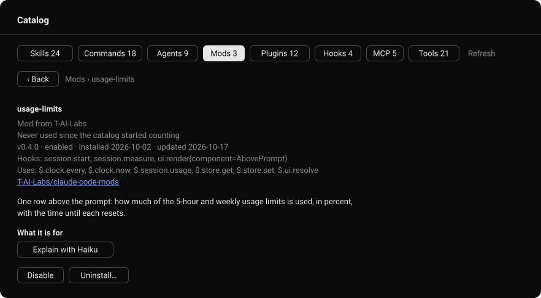

<h1 align="center">Claude Code Mods</h1>

<p align="center"><em>See your prompt-cache hit rate, context fill and usage limits at a glance, right above the Claude Code prompt, and browse everything your setup provides in one pane.</em></p>

<p align="center">
  <a href="https://github.com/T-AI-Labs/claude-code-mods/actions/workflows/ci.yml"></a>
  <a href="https://github.com/T-AI-Labs/claude-code-mods/releases"></a>
  <a href="https://github.com/T-AI-Labs/claude-code-mods/releases"></a>
  <a href="https://github.com/T-AI-Labs/claude-code-mods/releases"></a>
  <a href="LICENSE"></a>
  
  
</p>

<p align="center">
  <a href="#install"><strong>Install</strong></a> ·
  <a href="#cache-meter">cache-meter</a> ·
  <a href="#usage-limits">usage-limits</a> ·
  <a href="#catalog-pane">catalog-pane</a> ·
  <a href="#token-cost">Token cost</a> ·
  <a href="#configure">Configure</a> ·
  <a href="#update-and-uninstall">Update</a> ·
  <a href="#credits">Credits</a>
</p>

<p align="center"></p>

<p align="center"><sub>Illustration of cache-meter and usage-limits above the prompt, with the default settings.</sub></p>

## TL;DR

- **cache-meter** shows how much of each turn the prompt cache served, next to the context fill, and puts the auto-compact threshold, Compact and Clear one click away.
- **usage-limits** shows how much of the 5-hour and weekly limits is used, and how long until each resets.
- **catalog-pane** lists every skill, command, agent, mod, plugin, settings hook, MCP server and tool in a pane, with usage, token cost and buttons to use or manage each one.
- The two rows are one quiet line each. The figures stay neutral and only take a color when something needs attention.
- All three work in the Claude Code CLI and in the desktop app, alone or together. Together, the rows' columns line up.
- The rows make no network calls, run no external programs and add no tokens. See [Token cost](#token-cost) and, for the pane, [What catalog-pane reaches out to](#what-catalog-pane-reaches-out-to).

```
claude plugin marketplace add T-AI-Labs/claude-code-mods
claude plugin install cache-meter@T-AI-Labs
claude plugin install usage-limits@T-AI-Labs
claude plugin install catalog-pane@T-AI-Labs
```

## Install

Install only the mods you want. Run the commands above in any shell (cmd, PowerShell, bash). The mods load in every session started afterwards, in the terminal and in the desktop app.

From the prompt of a running Claude Code terminal session, the same install is:

```
/plugin install cache-meter --marketplace T-AI-Labs/claude-code-mods
/plugin install usage-limits --marketplace T-AI-Labs/claude-code-mods
/plugin install catalog-pane --marketplace T-AI-Labs/claude-code-mods
```

The mods use Claude Code's function-hook plugin API, which is in early access and may change between releases. They are built and tested against Claude Code 2.1.295, the engine in the Claude desktop app 2.31226.1.

## cache-meter

```
Cache ▮▮▮▮▮  92% (92k/100k) Context ▮▯▯▯▯  10% (100k/1M)  Auto 97% ▾  [ Compact ] [ Clear ]
```

| Element | What it shows |
| --- | --- |
| **Cache** | Share of the last turn's input tokens that the prompt cache served, with tokens read and total input in parentheses. Turns yellow below 40 %. |
| **Context** | Fill of the model's context window, with tokens used and window size in parentheses. Turns yellow within 15 points of the auto-compact threshold and red at it. |
| **Auto** | The auto-compact threshold: the context fill, as shown under **Context**, at which the mod compacts on its own. A dropdown over 97, 90, 70, 60 and 50 %. The choice is kept across sessions. |
| **Compact** | Runs `/compact` now. |
| **Clear** | Runs `/clear`. |

Both figures read `–` until the first response of a session, and again after a clear.

### How auto-compact works

After each turn the mod compares the context fill with the threshold and runs `/compact` once it is reached. It does not fire again until the fill has dropped below the threshold, so a compaction that lands above it does not loop.

Claude Code's built-in auto-compaction stays on and still runs at its own limit. A threshold above that limit therefore never fires, and a long turn can pass the threshold before the mod gets to compact.

### Token cost

Showing the rows costs nothing. The mods read figures Claude Code already has; they make no model requests of their own and add nothing to the conversation.

A compaction does cost tokens, whether you press Compact or the threshold triggers it: `/compact` is a model request that summarizes the conversation, and the next turn starts on a cold cache. The lower the threshold, the more often that happens. To keep usage down, leave the threshold high and compact by hand when it suits you.

## usage-limits

```
5h    ▮▮▯▯▯  42% (2h 13m)   Week    ▮▮▮▮▯  78% (3d 4h)
```

Each rate-limit window Claude Code reports gets a gauge, the percentage used and, in parentheses, the time left until it resets. `5h` is the 5-hour limit, `Week` the weekly one. A figure turns yellow from 75 % and red from 90 %.

The readings arrive with the first response of a session and are only reported on a subscription plan. Until then the row shows the last reading from an earlier session, dimmed, and drops a window once it has reset since. Without any reading it says `Usage limits: no reading yet`.

## catalog-pane

<p align="center"></p>

A pane that lists what the session can use, one tab per category: **Skills**, **Commands**, **Agents**, **Mods**, **Plugins**, **Hooks** (from the settings files), **MCP** servers and built-in **Tools**, each with its count. In the desktop app it opens with every session. `/catalog` opens it anywhere, `/catalog mods` on a category and `/catalog <text>` with a search.

Each row shows where the entry comes from, how often it was used, in total and in the last 30 days, and for plugin parts the tokens it adds to every session. On the desktop the list can be filtered by text and origin and sorted:

| Sort | Order |
| --- | --- |
| Most used, Recently used, Name | By the catalog's own usage counts, or alphabetically. |
| Clean-up | Costly and unused entries first, the candidates to remove. |
| GitHub stars, Trending, GitHub forks, Latest GitHub push | By the plugin's repository. Trending is stars gained per month. |
| Installs, Newest installed | By the official directory's install count, or by install date. |

<p align="center"></p>

Pressing an entry opens its detail: usage over 7 and 30 days, token cost, version and install dates, what a mod hooks and which engine calls it makes, the repository with its stars, and the full description. **Explain with Haiku** writes three sentences on what the entry is for and when to use it. The buttons depend on the kind: insert or run a skill or command, insert an agent, MCP server or tool into the prompt, update, disable or uninstall a plugin or mod, and remove a local MCP server. Uninstalling and removing ask first.

Usage is counted from the moment the mod is installed, so every entry starts at `never used`.

### What catalog-pane reaches out to

- **GitHub:** once a day, the public API for the stars, forks, open issues and last push of each plugin's repository. Turn it off with the `githubStats` option.
- **Haiku:** one short model request each time you press **Explain with Haiku**, at most 400 output tokens. The answer is kept, so each entry is explained once.
- **Claude Code CLI:** `claude plugin details` once per plugin version for its token cost, `claude plugin validate` once per mod version for what it hooks and calls, and `claude plugin update`, `disable`, `enable` or `uninstall` when you press those buttons.

Everything else it reads from Claude Code and the configuration files. Counts, costs and explanations are kept in the mod's own store.

## Configure

cache-meter and usage-limits take the same two options:

| Option | Values | Default | Effect |
| --- | --- | --- | --- |
| `display` | `gauge`, `text` | `gauge` | `gauge` draws a five-segment fill level before each percentage; `text` leaves it out. |
| `details` | `true`, `false` | `true` | Shows the figures in parentheses. |

Change them at any time from a shell, once per mod. In PowerShell:

```
'{"display":"text","details":"false"}' | claude plugin configure cache-meter@T-AI-Labs --values-stdin
```

In cmd:

```
echo {"display":"text","details":"false"} | claude plugin configure cache-meter@T-AI-Labs --values-stdin
```

Leave out an option to keep its value. `claude plugin configure cache-meter@T-AI-Labs` alone shows what is set. A new session picks up the change.

They can also be set while installing, with `--config display=text`, and in a terminal session they are rows of the `/config` menu. Give both mods the same settings to keep their columns aligned.

catalog-pane takes its own two, set the same way:

| Option | Values | Default | Effect |
| --- | --- | --- | --- |
| `language` | any language name | `English` | The language **Explain with Haiku** answers in. |
| `githubStats` | `true`, `false` | `true` | Fetches the GitHub stats of each plugin's repository once a day. |

### Fitting one line

cache-meter needs about 92 columns with the defaults. On a narrower window its buttons wrap to a second line. Turning `details` off saves about 22 columns, `display` set to `text` about 12:

```
Cache ▮▮▮▮▮  92% Context ▮▯▯▯▯  10%  Auto 97% ▾  [ Compact ] [ Clear ]
```

In the terminal, use the mouse, or move the focus into the row with `ctrl+x tab`: Tab walks the controls, Enter presses a button, and the arrow keys pick a threshold. To hide both rows there, collapse the band with its `[-]` mark or `ctrl+x ctrl+a`.

## Update and uninstall

```
claude plugin marketplace update T-AI-Labs
claude plugin update cache-meter@T-AI-Labs
claude plugin update usage-limits@T-AI-Labs
claude plugin update catalog-pane@T-AI-Labs
```

```
claude plugin uninstall cache-meter@T-AI-Labs
claude plugin uninstall usage-limits@T-AI-Labs
claude plugin uninstall catalog-pane@T-AI-Labs
```

A new session picks up the change.

## Credits

The idea for these mods comes from [Julian Ivanov](https://www.youtube.com/@Julian-Ivanov) and his video [Diese 10 Claude Code Mods solltest du unbedingt kennen](https://www.youtube.com/watch?v=ji4ANdb_M6Y). The code in this repository was written independently.

## License

[MIT](LICENSE)
