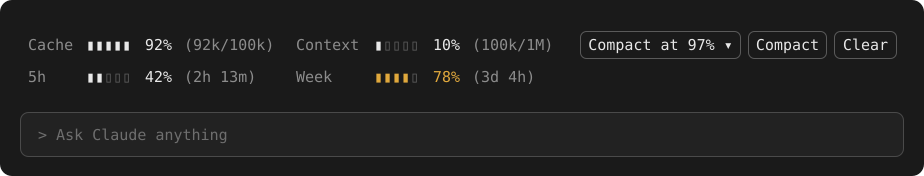

<h1 align="center">CCMods</h1>

<p align="center"><em>See your prompt-cache hit rate, context fill and usage limits at a glance, right above the Claude Code prompt.</em></p>

<p align="center">
  <a href="https://github.com/thorstenalpers/claude-code-mods/actions/workflows/ci.yml"></a>
  <a href="https://github.com/thorstenalpers/claude-code-mods/releases"></a>
  <a href="https://github.com/thorstenalpers/claude-code-mods/releases"></a>
  <a href="LICENSE"></a>
  
</p>

<p align="center">
  <a href="#install"><strong>Install</strong></a> ·
  <a href="#cache-meter">cache-meter</a> ·
  <a href="#usage-limits">usage-limits</a> ·
  <a href="#configure">Configure</a> ·
  <a href="#update-and-uninstall">Update</a>
</p>

<p align="center"></p>

<p align="center"><sub>Illustration of both mods above the prompt, with the default settings.</sub></p>

## TL;DR

- **cache-meter** shows how much of each turn the prompt cache served, next to the context fill, and puts Auto-compact, Compact and Clear one click away.
- **usage-limits** shows how much of the 5-hour and weekly limits is used, and how long until each resets.
- Each is one quiet line. The figures stay neutral and only take a color when something needs attention.
- They work in the Claude Code CLI and in the desktop app, alone or together. Together, their columns line up.
- No network calls and no external programs. The mods read figures Claude Code already has and run its own `/compact` and `/clear`.

```
claude plugin marketplace add thorstenalpers/claude-code-mods
claude plugin install cache-meter@claude-code-mods
claude plugin install usage-limits@claude-code-mods
```

## Install

Run the three commands above in any shell (cmd, PowerShell, bash). The mods load in every session started afterwards, in the terminal and in the desktop app.

From the prompt of a running Claude Code terminal session, the same install is:

```
/plugin install cache-meter --marketplace thorstenalpers/claude-code-mods
/plugin install usage-limits --marketplace thorstenalpers/claude-code-mods
```

The mods use Claude Code's function-hook plugin API, which is in early access and may change between releases. They are built and tested against Claude Code 2.1.295.

## cache-meter

```
Cache ▮▮▮▮▮  92% (92k/100k) Context ▮▯▯▯▯  10% (100k/1M)  [ Auto 97% ] [ Compact ] [ Clear ]
```

| Element | What it shows |
| --- | --- |
| **Cache** | Share of the last turn's input tokens that the prompt cache served, with tokens read and total input in parentheses. Turns yellow below 40 %. |
| **Context** | Fill of the model's context window, with tokens used and window size in parentheses. Turns yellow within 15 points of the auto-compact threshold and red at it. |
| **Auto** | The auto-compact threshold in percent. Each press steps through 97, 90, 70, 60 and 50. The choice is kept across sessions. |
| **Compact** | Runs `/compact`. |
| **Clear** | Runs `/clear`. |

Both figures read `–` until the first response of a session, and again after a clear.

### How auto-compact works

After each turn the mod compares the context fill with the threshold and runs `/compact` once it is reached. It does not fire again until the fill has dropped below the threshold, so a compaction that lands above it does not loop.

Claude Code's built-in auto-compaction stays on and still runs at its own limit. A threshold above that limit therefore never fires, and a long turn can pass the threshold before the mod gets to compact.

## usage-limits

```
5h    ▮▮▯▯▯  42% (2h 13m)   Week    ▮▮▮▮▯  78% (3d 4h)
```

Each rate-limit window Claude Code reports gets a gauge, the percentage used and, in parentheses, the time left until it resets. `5h` is the 5-hour limit, `Week` the weekly one. A figure turns yellow from 75 % and red from 90 %.

The readings arrive with the first response of a session and are only reported on a subscription plan. Until then the row reads `Usage limits: no reading yet`.

## Configure

Both mods take the same two options:

| Option | Values | Default | Effect |
| --- | --- | --- | --- |
| `display` | `gauge`, `text` | `gauge` | `gauge` draws a five-segment fill level before each percentage; `text` leaves it out. |
| `details` | `true`, `false` | `true` | Shows the figures in parentheses. |

Set them while installing:

```
claude plugin install cache-meter@claude-code-mods --config display=text
```

In a terminal session they are also rows of the `/config` menu. Give both mods the same settings to keep their columns aligned.

In the terminal, press a button with the mouse, or move the focus into the row with `ctrl+x tab` and use Tab and Enter.

## Update and uninstall

```
claude plugin marketplace update claude-code-mods
claude plugin update cache-meter@claude-code-mods
claude plugin update usage-limits@claude-code-mods
```

```
claude plugin uninstall cache-meter@claude-code-mods
claude plugin uninstall usage-limits@claude-code-mods
```

A new session picks up the change.

## License

[MIT](LICENSE)
