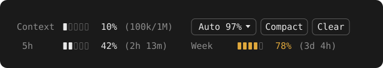
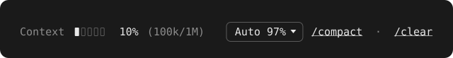
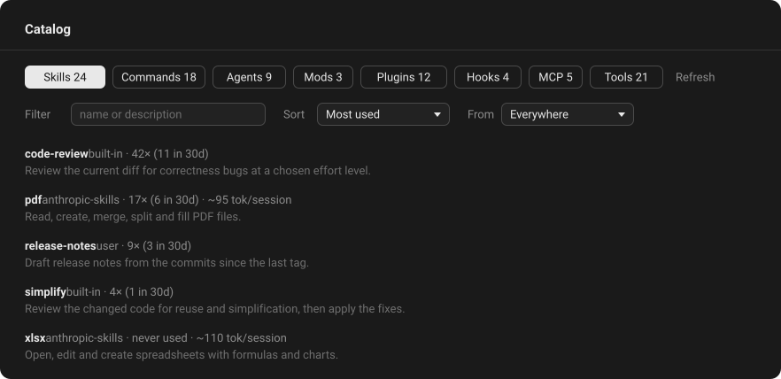

<h1 align="center">Claude Code Mods</h1>

<p align="center"><em>See your prompt-cache hit rate, context fill and usage limits at a glance, right above the Claude Code prompt, and browse everything your setup provides in one pane.</em></p>

<p align="center">
  <a href="https://github.com/T-AI-Labs/claude-code-mods/actions/workflows/ci.yml"></a>
  <a href="https://github.com/T-AI-Labs/claude-code-mods/releases"></a>
  <a href="https://github.com/T-AI-Labs/claude-code-mods/releases"></a>
  <a href="https://github.com/T-AI-Labs/claude-code-mods/releases"></a>
  <a href="https://github.com/T-AI-Labs/claude-code-mods/releases"></a>
  <a href="https://github.com/T-AI-Labs/claude-code-mods/releases"></a>
  <a href="LICENSE"></a>
</p>

<p align="center">
  <a href="#mods"><strong>Mods</strong></a> ·
  <a href="#configure">Configure</a> ·
  <a href="#update-and-uninstall">Update</a> ·
  <a href="#credits">Credits</a>
</p>

## Mods

Install only the mods you want, but not context-usage together with context-meter or usage-limits: it already contains both. Add the marketplace once, then install each mod with the command under its description, in any shell or in Claude Code with `/plugin` in place of `claude plugin`. New sessions load them.

```
claude plugin marketplace add T-AI-Labs/claude-code-mods
```

<table>
<tr><th>Mod</th><th>Description</th><th width="35%">Preview</th></tr>
<tr><td><a href="#context-usage">context&#8209;usage</a></td><td>

**Start here.** The context fill with the auto-compact threshold, Compact and Clear, and the 5-hour and weekly limits beneath it.

```
claude plugin install context-usage@T-AI-Labs
```

</td><td></td></tr>
<tr><td><a href="#context-meter">context&#8209;meter</a></td><td>

The context row of context-usage on its own.

```
claude plugin install context-meter@T-AI-Labs
```

</td><td></td></tr>
<tr><td><a href="#usage-limits">usage&#8209;limits</a></td><td>

The usage row of context-usage on its own.

```
claude plugin install usage-limits@T-AI-Labs
```

</td><td></td></tr>
<tr><td><a href="#cache-meter">cache&#8209;meter</a></td><td>

How much of each turn the prompt cache served and how long it stays warm, with a switch that keeps it warm while you are away.

```
claude plugin install cache-meter@T-AI-Labs
```

</td><td></td></tr>
<tr><td><a href="#catalog-pane">catalog&#8209;pane</a></td><td>

A pane listing every skill, command, agent, mod, plugin, settings hook, MCP server and tool, with usage, token cost and buttons to use or manage each one.

```
claude plugin install catalog-pane@T-AI-Labs
```

</td><td></td></tr>
</table>

The mods use Claude Code's function-hook plugin API, which is in early access and may change between releases. They are built and tested against Claude Code 2.1.295, the engine in the Claude desktop app 2.31226.1.

## Rows above the prompt

context-usage, cache-meter, context-meter and usage-limits each draw their rows in the band above the prompt. Compact and Clear are buttons on every surface; in the desktop app their row is drawn two lines high, so the app's taller buttons stay clear of the row below. Keep warm is a text link in the desktop app and a button in the terminal and the mobile app.

### context-usage

<p align="center"></p>

context-meter and usage-limits in one mod: the context row with its auto-compact threshold, Compact and Clear, and the usage-limits row beneath it. Each row works as described under [context-meter](#context-meter) and [usage-limits](#usage-limits). With `usagePosition` set to `above`, the usage row moves on top of the context row; see [Configure](#configure).

To switch from the two separate mods, install context-usage and uninstall context-meter and usage-limits. The threshold you picked does not carry over: pick it again.

### cache-meter

<p align="center"></p>

| Element | What it shows |
| --- | --- |
| **Cache** | Share of the last turn's input tokens that the prompt cache served, with tokens read and total input in parentheses. Turns yellow below 40 %. |
| **warm** / **cold** | How long the cache stays valid: it lapses five minutes after the start of the last request, or an hour once the mod has seen the session cache for that long. `cold` means the next turn writes the whole context again at full price, which also makes it the cheapest moment to compact or clear. |
| **Keep warm** | Off by default. Switched on, it refreshes the cache shortly before it lapses, for up to `keepWarmMinutes` after the last turn, and shows how many refreshes it made. It stops by itself when a refresh finds the cache already gone. |

The hit rate reads `–` until the first response of a session, and again after a clear.

#### Why the hit rate matters

Every turn sends the whole conversation again. Tokens the cache serves cost about a tenth of the normal input price, and a twentieth on Claude Opus 5.5; tokens written to it cost 1.25 times the input price. A high hit rate is a cheap turn, `0%` the most expensive kind. The cache lapses after a pause, on a model switch, and when something early in the context changes, such as CLAUDE.md or the tools.

#### What Keep warm costs

Each refresh is a request that reads the cached context once, at the cache price, plus a one-word reply. With 200k tokens on Claude Opus 5.5 that is about $0.04 a refresh, against about $1.00 for writing the context again after it went cold. Refreshes come about every four and a half minutes, so an hour costs about half of one rewrite: worth it when you come back, lost when you don't. On a subscription the refreshes count against the usage limits instead.

### context-meter

<p align="center"></p>

| Element | What it shows |
| --- | --- |
| **Context** | Fill of the model's context window, with tokens used and window size in parentheses. Turns yellow within 15 points of the auto-compact threshold and red at it; with Auto off, within 15 points of 100 % and red at 100 %. |
| **Auto** | The auto-compact threshold: the context fill, as shown under **Context**, at which the mod compacts on its own. A dropdown over Off, 97, 90, 70, 60 and 50 %; Off leaves compacting to you and to Claude Code's built-in auto-compaction. The choice is kept across sessions. |
| **Compact** | Runs `/compact` now. |
| **Clear** | Runs `/clear`. |

The fill reads `0%` with the window size until the first response of a session, and again after a clear: the engine counts the system prompt and tools only once a response arrives.

#### How auto-compact works

After each turn the mod compares the context fill with the threshold and runs `/compact` once it is reached. It does not fire again until the fill has dropped below the threshold, so a compaction that lands above it does not loop.

Claude Code's built-in auto-compaction stays on and still runs at its own limit. A threshold above that limit therefore never fires, and a long turn can pass the threshold before the mod gets to compact.

### usage-limits

<p align="center"></p>

Each rate-limit window Claude Code reports gets a gauge, the percentage used and, in parentheses, the time left until it resets. `5h` is the 5-hour limit, `Week` the weekly one. A figure turns yellow from 75 % and red from 90 %.

`5h` and `Week` are always shown. The readings arrive with the first response of a session and are only reported on a subscription plan. Until then, and again right after a `/clear`, the row shows the last reading, with a window that has reset since at 0 %. A window a measurement leaves out keeps its last reading, and only a window that never had one shows `–`.

Sessions running side by side share their readings. Each one stores what it measures, and once a minute every session takes in what the others stored: of two readings of the same window the higher one, and a window that resets later over the one before it. A session that has been idle for a while therefore shows the use of the others too, at no token cost, since it only reads a file on your machine. context-usage and usage-limits keep separate stores and do not share with each other.

### Token cost

Showing the rows costs nothing. The mods read figures Claude Code already has and add nothing to the conversation; the one model request any of them makes is cache-meter's refresh while Keep warm is on.

A compaction does cost tokens, whether you press Compact or the threshold triggers it: `/compact` is a model request that summarizes the conversation, and the next turn starts on a cold cache. The lower the threshold, the more often that happens. To keep usage down, leave the threshold high and compact by hand when it suits you.

## catalog-pane

<p align="center"></p>

A pane that lists what the session can use, one tab per category: **Skills**, **Commands**, **Agents**, **Mods**, **Plugins**, **Hooks** (from the settings files), **MCP** servers and built-in **Tools**, each with its count. It stays closed until you ask for it: `/catalog` opens it, in the desktop app and in the terminal, `/catalog mods` on a category and `/catalog <text>` with a search.

Each row shows where the entry comes from, how often it was used, in total and in the last 30 days, and for plugin parts the tokens it adds to every session. On the desktop the list can be filtered by text and origin and sorted:

| Sort | Order |
| --- | --- |
| Most used, Recently used, Name | By the catalog's own usage counts, or alphabetically. |
| Clean-up | Costly and unused entries first, the candidates to remove. |
| GitHub stars, Trending, GitHub forks, Latest GitHub push | By the plugin's repository. Trending is stars gained per month. |
| Installs, Newest installed | By the official directory's install count, or by install date. |

<p align="center"></p>

Pressing an entry opens its detail: usage over 7 and 30 days, token cost, version and install dates, what a mod hooks and which engine calls it makes, the repository with its stars, and the full description. **Explain with Haiku** writes three sentences on what the entry is for and when to use it. The buttons depend on the kind: insert or run a skill or command, insert an agent, MCP server or tool into the prompt, update, disable or uninstall a plugin or mod, and remove a local MCP server. Uninstalling and removing ask first.

Usage is counted from the moment the mod is installed, so every entry starts at `never used`.

### What catalog-pane reaches out to

- **GitHub:** once a day, the public API for the stars, forks, open issues and last push of each plugin's repository. Turn it off with the `githubStats` option.
- **Haiku:** one short model request each time you press **Explain with Haiku**, at most 400 output tokens. The answer is kept, so each entry is explained once.
- **Claude Code CLI:** `claude plugin details` once per plugin version for its token cost, `claude plugin validate` once per mod version for what it hooks and calls, and `claude plugin update`, `disable`, `enable` or `uninstall` when you press those buttons.

Everything else it reads from Claude Code and the configuration files. Counts, costs and explanations are kept in the mod's own store.

## Configure

cache-meter, context-usage, context-meter and usage-limits take the same two options:

| Option | Values | Default | Effect |
| --- | --- | --- | --- |
| `display` | `gauge`, `text` | `gauge` | `gauge` draws a five-segment fill level before each percentage; `text` leaves it out. |
| `details` | `true`, `false` | `true` | Shows the figures in parentheses. |

context-usage also takes `usagePosition`, `below` or `above` (default `below`): where the usage row sits, under the context row or on top of it.

cache-meter also takes `keepWarmMinutes`, one of `15`, `30`, `60` or `120` (default `60`): how long after the last turn Keep warm goes on refreshing.

Change them at any time from a shell, once per mod. In PowerShell:

```
'{"display":"text","details":"false"}' | claude plugin configure cache-meter@T-AI-Labs --values-stdin
```

In cmd:

```
echo {"display":"text","details":"false"} | claude plugin configure cache-meter@T-AI-Labs --values-stdin
```

Leave out an option to keep its value. `claude plugin configure cache-meter@T-AI-Labs` alone shows what is set. A new session picks up the change.

They can also be set while installing, with `--config display=text`, and in a terminal session they are rows of the `/config` menu. Give the mods the same settings to keep their columns aligned.

catalog-pane takes its own two, set the same way:

| Option | Values | Default | Effect |
| --- | --- | --- | --- |
| `language` | any language name | `English` | The language **Explain with Haiku** answers in. |
| `githubStats` | `true`, `false` | `true` | Fetches the GitHub stats of each plugin's repository once a day. |

### Fitting one line

context-usage and context-meter need about 62 columns with the defaults. On a narrower window the buttons wrap to a second line. Turning `details` off saves about 11 columns, `display` set to `text` about 6:

<p align="center"></p>

In the terminal, use the mouse, or move the focus into the row with `ctrl+x tab`: Tab walks the controls, Enter presses a button, and the arrow keys pick a threshold. To hide the rows there, collapse the band with its `[-]` mark or `ctrl+x ctrl+a`.

## Update and uninstall

```
claude plugin marketplace update T-AI-Labs
claude plugin update context-usage@T-AI-Labs
claude plugin update cache-meter@T-AI-Labs
claude plugin update usage-limits@T-AI-Labs
claude plugin update catalog-pane@T-AI-Labs
claude plugin install context-meter@T-AI-Labs
```

Since 0.4.0 cache-meter shows the cache alone; the context fill, the threshold and the Compact and Clear buttons moved to context-meter, which an update does not install by itself. The threshold you picked in cache-meter does not carry over: pick it again in context-meter.

```
claude plugin uninstall context-usage@T-AI-Labs
claude plugin uninstall cache-meter@T-AI-Labs
claude plugin uninstall context-meter@T-AI-Labs
claude plugin uninstall usage-limits@T-AI-Labs
claude plugin uninstall catalog-pane@T-AI-Labs
```

A new session picks up the change.

## Credits

The idea for these mods comes from [Julian Ivanov](https://www.youtube.com/@Julian-Ivanov) and his video [Diese 10 Claude Code Mods solltest du unbedingt kennen](https://www.youtube.com/watch?v=ji4ANdb_M6Y). The code in this repository was written independently.

## License

[MIT](LICENSE)
